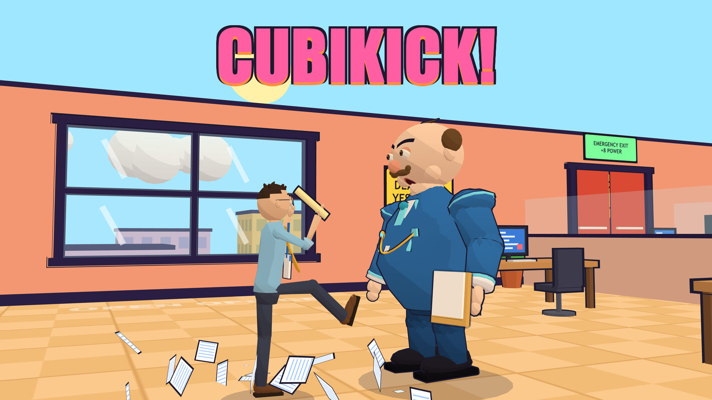
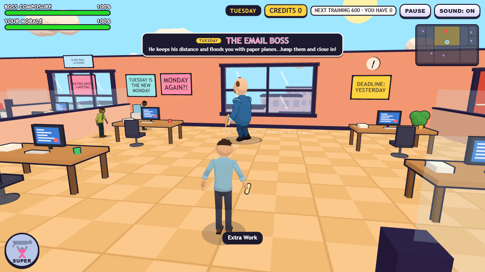
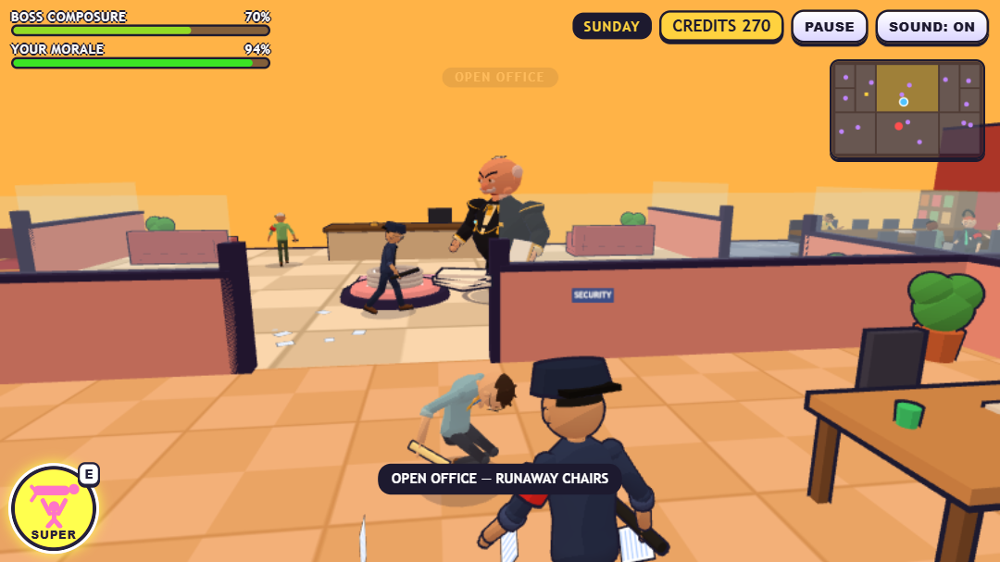
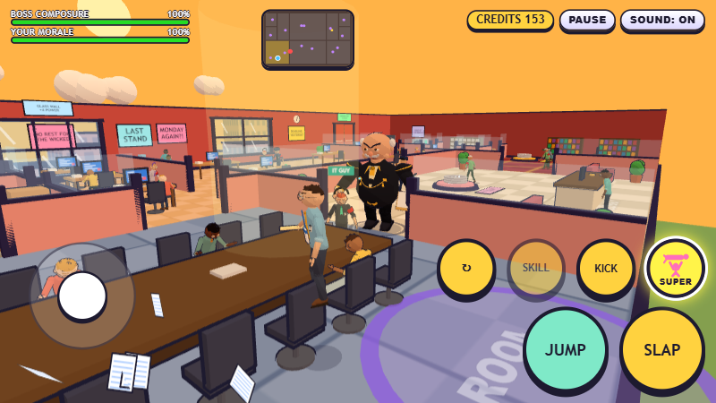
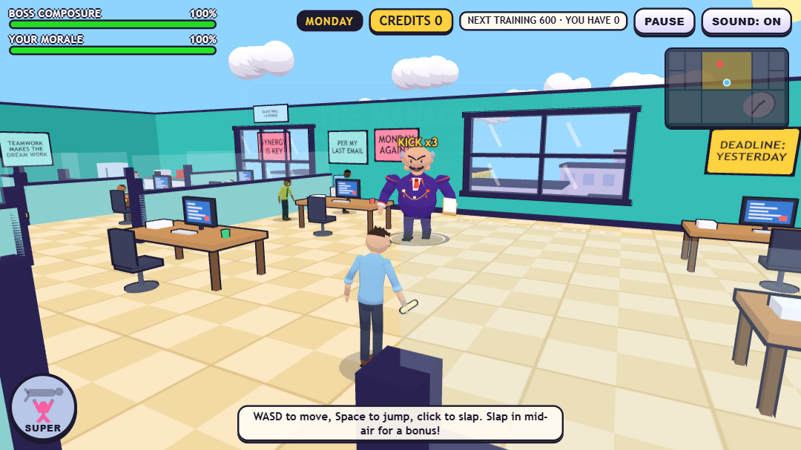
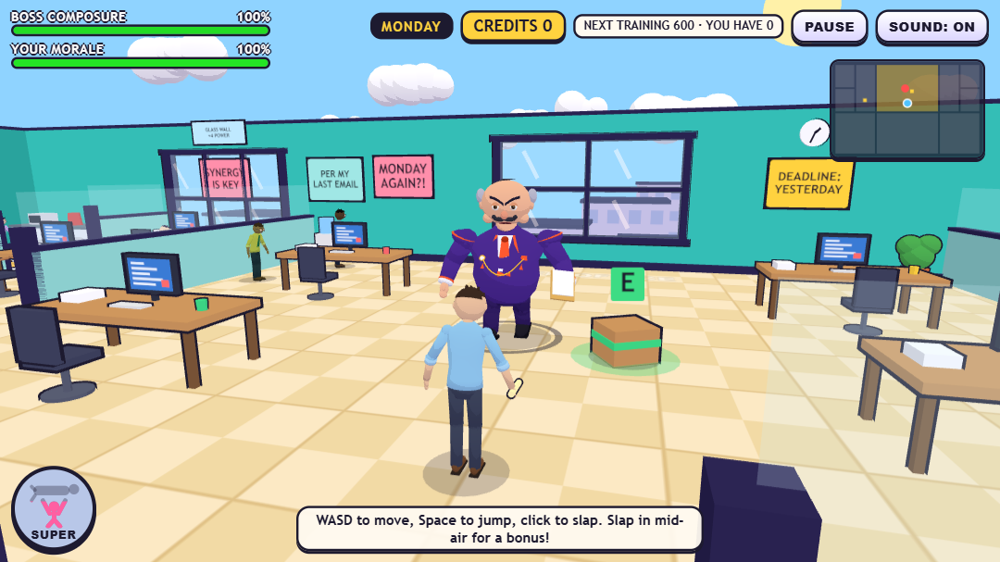
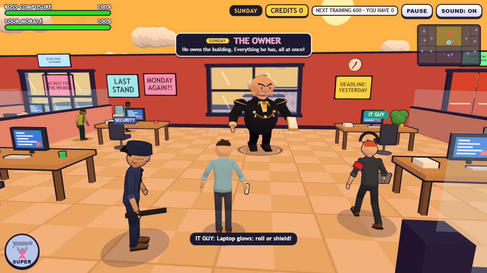

# CubiKick!

A silent cartoon office comedy for the browser. An ordinary employee slaps, kicks and finally *Super-Shoves* a terrible boss out of the building, through the window, the glass wall or the emergency door, and sends him flying to the Moon, Mars and beyond. No spoken dialogue, no blood and no injury: slapstick only.

> **Play the demo:** `DEMO_LINK_TO_BE_ADDED`
> *(placeholder: the link will be filled in after GitHub Pages is enabled)*

---

## My role

Game concept, gameplay design, testing and release preparation, with AI-assisted development using Claude Code and ChatGPT/Codex.

## Tech stack

| Area | What is used |
| --- | --- |
| 3D engine | [Three.js](https://threejs.org/) 0.186 (WebGL), toon shading with outlines |
| Language | TypeScript 5.9 |
| Build and dev server | Vite 8 |
| Unit tests | Vitest (247 tests) |
| Portal integration | CrazyGames SDK v3 (Data-module save, gameplay start/stop events, mute setting). *The CrazyGames SDK is used in the portal build; this portfolio demo does not load it.* |
| Art | Characters and props built from scripts in Blender and exported as `.glb` |
| Sound | Generated in code with the Web Audio API (no audio files) |

## Gameplay features

- Seven boss stages, one boss per day: the Manager, the Email Boss, the HR Manager, the Consultant, the Party Boss, the CTO and the Owner, each with his own look and way of fighting.
- A ten-room office (pantry, server room, mail room, lobby, meeting room, executive suite and more). Every room has its own look and its own hazard, from runaway chairs to laser gates.
- The boss's crew guards the rooms: Security, Intern, HR Drone, IT Guy, Accountant and Courier, each with a power of their own.
- Slap, jump-slap, kick, back-kick and a charged **Super Shove** that grabs, spins and throws the boss out of the building. The harder you play, the farther he flies.
- Eight playable employees, fifteen skills (found in crates or bought), a credit shop with training, and three play styles (Relaxed, Classic, Challenge) plus an Overtime mode.
- Text-only, English-only interface and a silent comedy style, so there is nothing to translate.

## Mobile and desktop support

- Desktop: keyboard and mouse (WASD or arrows, Space, click or J, K, E, F).
- Mobile: landscape touch controls (thumb stick on the left, JUMP, SLAP, KICK and SUPER buttons on the right). The layout was checked at 800×450, 821×462, 1080×607 and 1280×720, and on very short phone screens (740×260 and 740×335).
- The layout, text sizes and boss-introduction panel were checked in a desktop browser at those sizes. **It has not been tested on a real phone yet** (see limitations).

## Performance work

Measured on a deliberately low-end laptop (Intel Core i5-8350U, integrated UHD 620 graphics, 8 GB RAM) in a real Chrome 154, with the minified release build, at 1280×720, device pixel ratio 1, cache disabled and a script-controlled "bot" playing for 25-second runs. Results vary between runs, so the numbers below are rough measurements, not promises.

- **Frame rate:** about 40-50 FPS (median) in busy stages on that laptop, and in the low 30s in the busiest stage when the laptop was also busy with other programs; a steady 60 FPS has **not** been reached there.
- **Draw calls:** the office was merged into far fewer meshes (the office alone went from 177 to about 65 draw calls), and transparent double-sided materials are drawn once instead of twice.
- **Stage start:** a "preparing" phase builds the crew, the boss and the destination planet before the player gets control; frames longer than 50 ms right after the start dropped from about 6-10 to 0-3.
- **Loading:** a cold-cache load reaches a usable menu in about 1.4 s on the local machine (about 5.1 MB downloaded). In a simulated "Slow 4G" connection (1.6 Mbps, 150 ms latency) the menu appears after about 14.5 s, with about 2.7 MB needed first; the background characters load afterwards.
- **Timing:** the world runs in fixed steps, so game speed no longer depends on the frame rate (checked from 10 to 165 Hz with a fake clock).
- **Memory:** no growth was found over repeated stage starts; comic-word pictures are kept in a small least-recently-used cache.

## Testing status

| Area | Status |
| --- | --- |
| Type-check (`tsc --noEmit`) | Clean |
| Unit tests (Vitest) | 247 tests passing (rules, launch arc, collisions, skills, save logic, timing, HUD rules) |
| Real Chrome and Edge (desktop) | Measured, no console errors in the test runs |
| Portal SDK behaviour | Checked only against a **test double** of the SDK (fresh guest, SDK missing, init failure, SDK disabled, late init, save failures) |
| Phone emulation | A 4× CPU slow-down at 800×360 gave about 10 FPS; this is an emulation, **not** a real device |
| Real phone, Safari, Firefox, low-memory Chromebook | **Not tested** |
| CrazyGames Portal Preview | **Not tested** |

## Screenshots

| | |
| --- | --- |
|  |  |

## Current limitations

- A steady 60 FPS is not reached on the low-end laptop used for testing; stage 6 (Sunday, the busiest) is the slowest.
- Phone performance is unknown. The emulated result suggests that low-end phones will struggle in busy rooms.
- No real-device, Safari or Firefox testing yet.
- The game has not been accepted or published on any portal; the CrazyGames submission is still in preparation.
- Everything is in English, text only.
- The 3D models and the compiled game code are served to the browser by the public demo, so anyone can download them.

## About this repository

This is a **portfolio** repository: it holds this README, screenshots and the compiled demo (`docs/`). The full source code is kept in a separate private repository.

The demo is the normal web build. The CrazyGames submission build is different in two small ways: it loads the CrazyGames SDK script, and it leaves out the custom fullscreen and landscape buttons because the portal provides its own.

## Contact

- Name: MDSHRIRAM
- Contact via [GitHub profile](https://github.com/MDSHRIRAM)

## License

All rights reserved.
